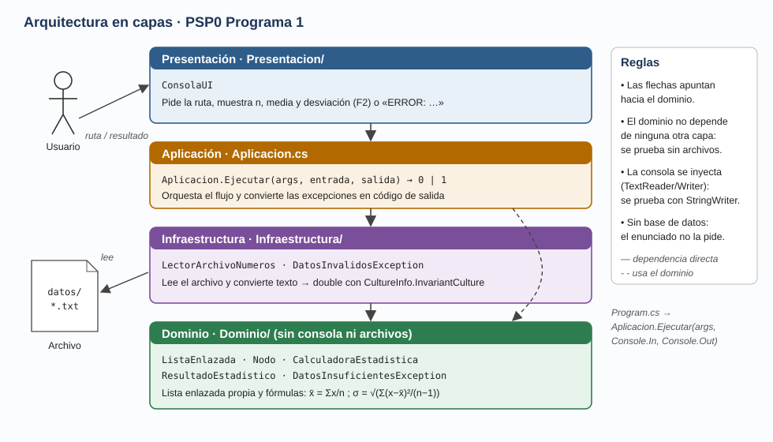
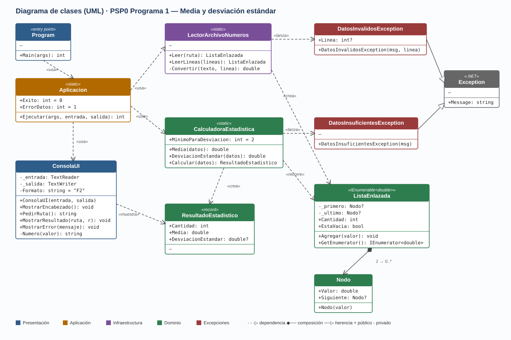
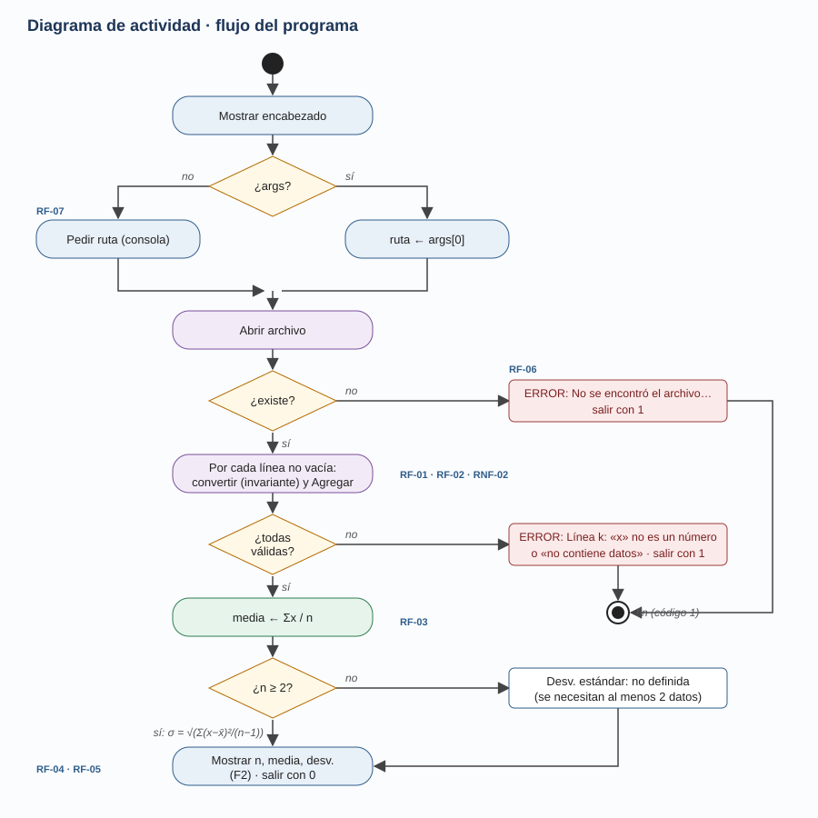
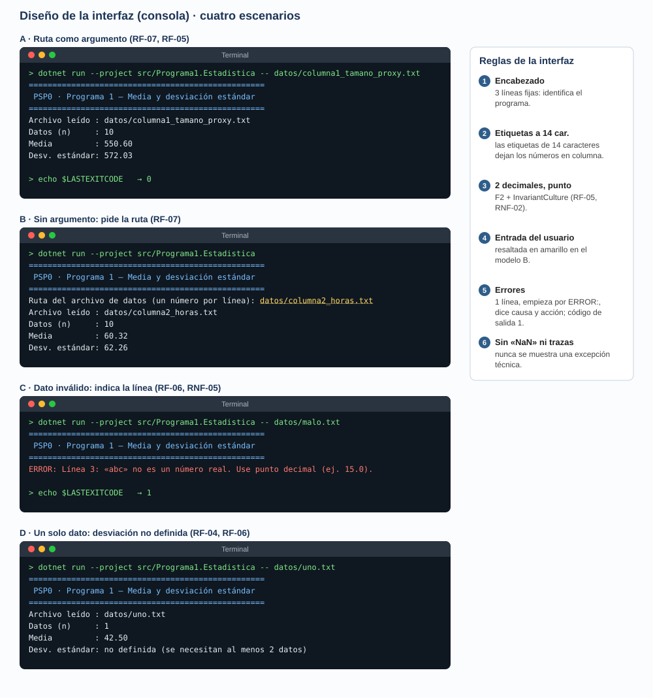

# Documento de diseño técnico: Programa 1

El diseño traduce los requisitos del sistema (RF-01 a RF-07 y RNF-01 a RNF-08) en una solución modular y estructurada en C# (.NET 9), asegurando alta cohesión y bajo acoplamiento entre capas.

## 1. Arquitectura en capas

El sistema adopta una arquitectura en capas concéntricas con regla de dependencia hacia el dominio:

| Capa | Ubicación en el proyecto | Responsabilidad asignada | Requisitos asociados |
|---|---|---|---|
| Presentación | `Presentacion/ConsolaUI.cs` | Solicitar la ruta del archivo, formatear la salida y mostrar mensajes de error. No realiza cálculos ni accede al sistema de archivos. | RF-05, RF-07, RNF-05 |
| Aplicación | `Aplicacion.cs`, `Program.cs` | Orquestar el flujo general: procesar argumentos, invocar la lectura de datos, coordinar el cálculo y retornar códigos de salida (0 o 1). | RF-06, RF-07, RNF-08 |
| Infraestructura | `Infraestructura/LectorArchivoNumeros.cs` | Leer el archivo de texto línea por línea, ignorar líneas vacías y convertir cadenas a números con cultura invariante. | RF-01, RF-06, RNF-02 |
| Dominio | `Dominio/` | Implementar la lista enlazada, los nodos y los cálculos de media y desviación estándar. Es completamente independiente de la consola y del sistema de archivos. | RF-02, RF-03, RF-04, RNF-03, RNF-06 |

## 2. Diagrama de clases

La solución desacopla el almacenamiento de datos del algoritmo de cálculo mediante la interfaz estándar `IEnumerable<double>`:

* `Nodo`: Clase sellada que encapsula el valor numérico (`double`) y la referencia al siguiente nodo.
* `ListaEnlazada`: Gestiona los nodos manteniendo referencias al primer y último elemento para lograr inserción O(1).
* `CalculadoraEstadistica`: Clase estática pura que opera sobre la lista enlazada para obtener la media y la desviación estándar muestral.
* `ResultadoEstadistico`: Registro inmutable que almacena la cantidad de elementos, la media calculada y la desviación estándar (la cual puede ser nula si n < 2).
* `DatosInsuficientesException`: Excepción de dominio arrojada ante conjuntos sin suficientes datos para calcular.
* `DatosInvalidosException`: Excepción de infraestructura arrojada ante rutas inválidas, archivos vacíos o errores de formato numérico.

## 3. Flujo de ejecución del programa

El comportamiento del sistema ante rutas provistas o interactivas se ilustra en el siguiente diagrama:

1. El programa inicia configurando la codificación de la consola en UTF-8.
2. Si existen argumentos en la invocación (`args[0]`), toma dicha ruta; de lo contrario, solicita la ruta interactivamente por consola.
3. Se intenta leer el archivo de texto y construir la lista enlazada.
4. Si la lectura es exitosa, se efectúan los cálculos de media y desviación estándar.
5. Se imprimen los resultados alineados con dos decimales y el programa finaliza con código 0.
6. Si ocurre algún error en la lectura o los datos son insuficientes, se captura la excepción correspondiente, se imprime el mensaje de error que inicia con "ERROR:" y el programa finaliza con código 1.

## 4. Diseño de la interfaz de consola

La consola presenta un formato limpio y alineado para facilitar la lectura de los resultados:

* Encabezado de tres líneas delimitado por caracteres iguales.
* Etiquetas descriptivas alineadas a 14 caracteres:
  * `Archivo leído : [ruta]`
  * `Datos (n)     : [cantidad]`
  * `Media         : [valor con dos decimales]`
  * `Desv. estándar: [valor con dos decimales o mensaje de no definida]`
* Mensajes de error concisos en una sola línea que inician obligatoriamente con el prefijo `ERROR:`.

## 5. Justificación del almacenamiento en memoria (sin base de datos)

El enunciado del proyecto solicita leer n números reales desde un archivo de texto plano y almacenarlos en memoria mediante una lista enlazada propia para calcular estadísticas puntuales.

No se utiliza una base de datos porque:
* El problema no exige persistencia de datos entre ejecuciones ni consultas transaccionales.
* Incorporar un motor de base de datos (como SQLite o PostgreSQL) agregaría dependencias externas, configuración de esquemas y complejidad técnica innecesaria que no aporta a ningún requisito funcional.
* El uso de archivos de texto con números por línea permite reproducir y verificar las pruebas del Assignment Kit de forma directa y portable en cualquier equipo.

## 6. Traza de escritorio manual (Tabla 3)

Se verifica manualmente la secuencia matemática del pseudocódigo con los 10 valores de la Tabla 3 (186, 699, 132, 272, 291, 331, 199, 1890, 788, 1601):

* Cantidad de elementos (n): 10
* Sumatoria de x: 6389.0
* Media calculada: x̄ = 6389.0 / 10 = 638.90
* Desviaciones al cuadrado:
  * (186 - 638.90)² = 205118.41
  * (699 - 638.90)² = 3612.01
  * (132 - 638.90)² = 256947.61
  * (272 - 638.90)² = 134615.61
  * (291 - 638.90)² = 121034.41
  * (331 - 638.90)² = 94802.41
  * (199 - 638.90)² = 193512.01
  * (1890 - 638.90)² = 1565251.21
  * (788 - 638.90)² = 22230.81
  * (1601 - 638.90)² = 925636.41
* Suma de cuadrados: 3522760.90
* Varianza muestral (dividida entre n - 1 = 9): 391417.88
* Desviación estándar (raíz cuadrada): 625.63

La traza manual confirma la exactitud de la fórmula muestral antes de iniciar la etapa de codificación.

## 7. Matriz de trazabilidad (Requisitos vs. Componentes de diseño)

| Requisito | Componente / Método responsable | Caso de prueba asociado |
|---|---|---|
| RF-01 | `LectorArchivoNumeros.Leer`, `LeerLineas` | CP-09, CP-14 |
| RF-02 | `ListaEnlazada.Agregar`, enumerador de nodos | CP-08 |
| RF-03 | `CalculadoraEstadistica.Media` | CP-01, CP-02, CP-03, CP-07 |
| RF-04 | `CalculadoraEstadistica.DesviacionEstandar` | CP-01, CP-02, CP-03, CP-05, CP-06 |
| RF-05 | `ConsolaUI.MostrarResultado` | CP-15 |
| RF-06 | `DatosInvalidosException`, `DatosInsuficientesException` | CP-04, CP-10, CP-11, CP-12, CP-17 |
| RF-07 | `Aplicacion.Ejecutar`, `ConsolaUI.PedirRuta` | CP-15, CP-16 |
| RNF-01 | Configuración de proyecto `net9.0` | CP-15 |
| RNF-02 | Conversión con `CultureInfo.InvariantCulture` | CP-13 |
| RNF-03 | Operaciones en tipo `double` | CP-01, CP-02, CP-03 |
| RNF-04 | Estructura en capas y compilación estricta | Inspección de compilación |
| RNF-05 | Mensajes de error con formato `ERROR:` | CP-10, CP-11, CP-12, CP-17 |
| RNF-06 | Inserción en tiempo constante O(1) con puntero `_ultimo` | CP-08 |
| RNF-07 | Ejecución manual directa por consola | CP-01 a CP-18 |
| RNF-08 | Registro de confirmaciones en Git por fase PSP0 | Historial de commits |
